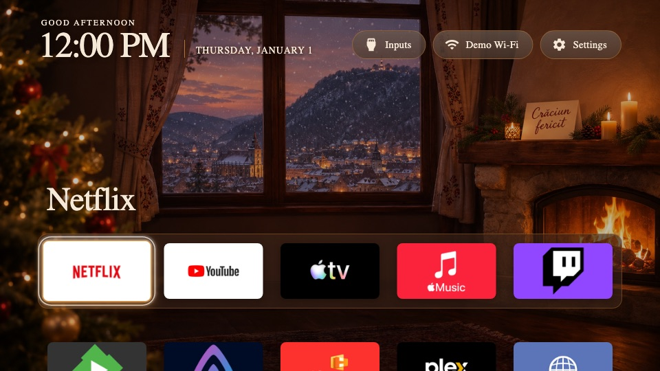

# Clean Your TV themes

Themes for [Clean Your TV for LG webOS](https://github.com/Razdva122/clean-your-tv-lg-webos).

## Crăciun la Brașov

Christmas evening by a crackling fireplace in a Romanian home, with snowy Brașov, the Tâmpa and the
Black Church through the window, and a "Crăciun fericit" card on the mantel. Warm fire, walnut and
cream, serif type, classic dock-grid layout with 5 columns.

- Since 1.1.0 the wallpaper is 3840×2160 (upscaled from the original render, see `CREDITS.txt`);
  it needs a Home with UHD wallpaper support (1.7.0 or later).
- Tried on an LG OLED65C3LA (No-root edition, Home 1.7.0).
- The wallpaper is AI-generated (OpenAI Codex image generation) and released under CC BY 4.0;
  the CSS is MIT. See `themes/craciun/LICENSE.txt` and `CREDITS.txt`.
